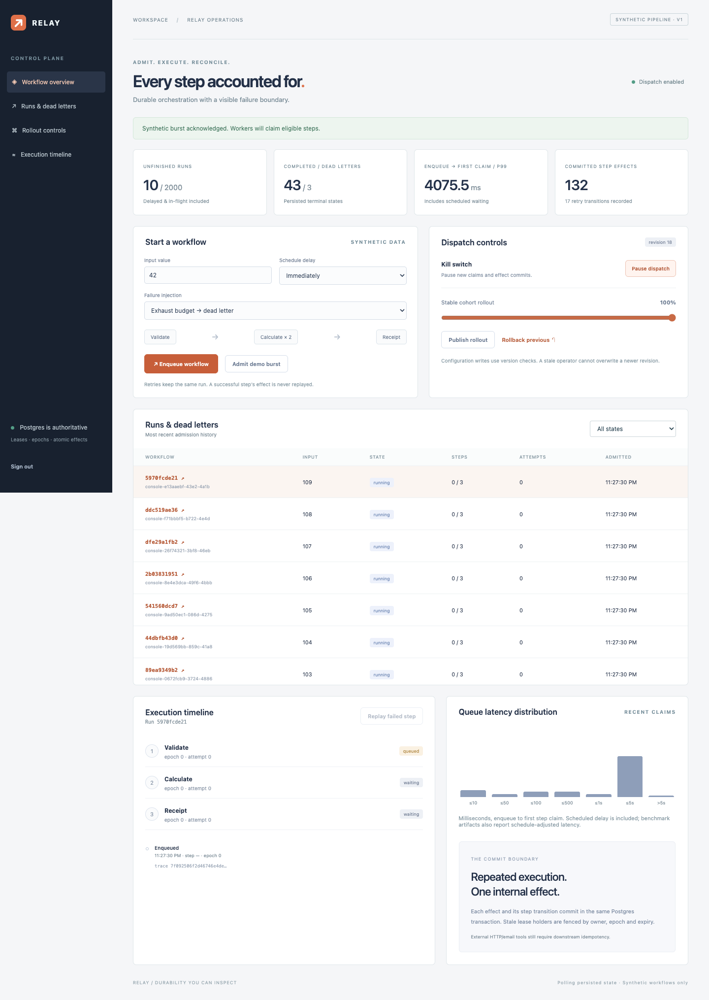
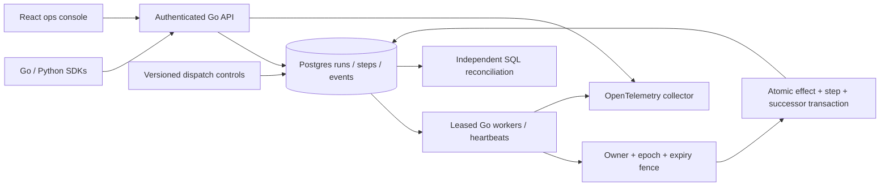

# Relay

## Problem

Keep ordered workflow steps recoverable after worker and connection failures without repeating committed internal effects.

**Status: partial — live deployment and complete hour audit export are outstanding.** [Public repository](https://github.com/rjrddy/relay) · [Demo recording](https://raw.githubusercontent.com/rjrddy/relay/main/docs/results/demo.webm) · [Interview kit](INTERVIEW.md).

## Results

Every result below is rendered from saved command output in [docs/results](docs/results/), with raw per-run timing, reconciliation, events and worker logs. These are synthetic workflows on the recorded development environment, not company usage or production capacity claims.

| Proof | Observed result | Evidence |
|---|---|---|
| Unit / integration / property / race checks | 18 tests passed, 0 failures | [test summary](docs/results/tests.json), [raw events](docs/results/tests.jsonl) |
| Sustained chaos campaign | 67,688 workflows / 203,064 effects over 1.000288 measured wall-clock hours; 0 lost workflows / 0 duplicate effects | [campaign](docs/results/chaos-hour.json), [reconciliation](docs/results/chaos-hour-reconciliation.json), [recovered audit prefix](docs/results/chaos-hour-events-prefix.jsonl.gz), [export failure](docs/results/hour-export-status.json) |
| Short chaos campaign | 1,390 workflows, 0 lost / 0 duplicate effects in 60.024 seconds | [result](docs/results/chaos.json), [raw reconciliation](docs/results/chaos-reconciliation.json) |
| Linux storage-sync fault | 12 of 12 scheduled workflows completed; 0 duplicate effects | [raw rows](docs/results/linux-storage/storage-fault.json), [Postgres log](docs/results/linux-storage/storage-fault.log) |
| Browser recovery and operator flow | lost acknowledgement deduplicated; completed prefix preserved; page errors: 0 | [browser result](docs/results/browser.json), [original prefix](docs/results/browser-before-replay.json) |
| Actual screen recording | 90.52 seconds | [video](docs/results/demo.webm), [ffprobe output](docs/results/demo-probe.json) |

The long run lasted 3601.037 seconds with 4 configured steady worker processes. Its p99 enqueue-to-first-claim was 273.44 ms. Fault timing is recorded in the result, not inferred from simulated time.

Load sweep, including engine admission through all ordered effects and drain:

| Workflows | Step effects | Workflows / second | First-claim p50 ms | First-claim p99 ms | Lost workflows / duplicate effects |
|---|---|---|---|---|---|
| 100 | 300 | 156.49 | 420.89 | 430.28 | 0 / 0 |
| 500 | 1500 | 319.98 | 335.67 | 447.25 | 0 / 0 |
| 1000 | 3000 | 101.05 | 6047.79 | 7539.97 | 0 / 0 |

[Full required gate](docs/results/checks.log) runs `make lint test bench`; [environment/source hashes](docs/results/checks.json) and [database durability settings](docs/results/database-environment.json) describe the measurement environment. Native trace export is disabled; export overhead and HTTP API throughput are **not measured**. First-claim latency uses the stored database enqueue and first-claim timestamps. It excludes waiting to enter admission, HTTP transport and worker instructions after the claim; request-to-handler-start latency is not measured. It includes queueing and requested schedule delay; raw reconciliation also records schedule-adjusted latency. This is a burst/steady synthetic workload, not a hard real-time SLO.

The chaos harness terminates real worker processes after claim and after commit, then repeatedly closes/delays worker-to-Postgres TCP connections. The producer/observer stays directly connected so it can independently reconcile. A process exiting after observing commit is not falsely labeled a network-dropped COMMIT acknowledgement. The separate browser experiment replaces a real successful admission response with a failure, reloads, and proves the retry acknowledges the existing run. The storage experiment delays actual fsync/fdatasync calls, not a simulated timer in a handler; it is not a failing physical-device benchmark.

Caught failures are retained: a stale completion is rejected by the fenced-lease test in raw test output; [the initial real storage-fault gate](docs/results/ci-initial-failure.log) caught an unhandled admission failure. SDK retries now preserve immutable keys. The passing storage test admits scheduled jobs before activating its fault and proves worker durability; it does **not** reinterpret the earlier error as a successful admission-latency test.



## Architecture



## Run it

From a clone with Docker Compose and Python installed:

```sh
python3 scripts/configure.py
docker compose up --build
```

The configuration script creates ignored local secrets without printing them. Open .env locally to copy your operator password, then sign in at http://localhost:8080. Compose seeds synthetic workflows and starts the API, independent workers, Postgres and a trace collector. Normal Compose never loads the storage-fault shim. No external account is required.

For native setup, SDK examples, test-database configuration and benchmark commands, see [development](docs/DEVELOPMENT.md). For the exact recording flow, see [demo steps](docs/DEMO.md). [Optional deployment configuration](deploy/render.yaml) is prepared but **not deployed**.

## Decisions and limits

Read [DESIGN.md](docs/DESIGN.md), [ADRs](docs/adr), [migration provenance](docs/migration/relay.md), [INTERVIEW.md](INTERVIEW.md), [DRILL.md](docs/DRILL.md) and [quality report](docs/QUALITY.md).

- Execution is at least once. The one-effect guarantee applies to uniquely keyed internal Postgres effects committed with step state, not arbitrary HTTP/email/payment tools.
- This is a versioned ordered synthetic pipeline, not a general DAG compiler or arbitrary code-execution service. Scheduling is a one-shot relative delay stored as a database timestamp; cron is absent.
- Admission and control publication serialize on a central row. This is a known bottleneck, and storage stalls can produce bounded retryable unavailability. Idempotent retries are required; no admission SLO is claimed during those stalls.
- Lease epochs survive replay. Completed prefix effects are retained. Bounded attempts can intentionally terminate work in dead letters; a dead letter is not relabeled as success or silently discarded.
- Pause is a transaction barrier for new claims and internal effect commits. It cannot undo already committed work. Rollout changes affect claim eligibility.
- No multitenant isolation, database-replica failover, cross-region consensus, external-effect exactly-once guarantee or automated retention/backup is implemented.
- Operator sessions are local to the API process; SDKs use a separate provisioned bearer token. Hosted TLS and Secure cookies are required. The demo database role can migrate schema; production should separate migration credentials from runtime permissions.
- Async OpenTelemetry export is verified, but spans can be lost on crashes and there is no long-term trace backend. Postgres state/events are authoritative.
- The hour protocol reconciliation completed, but the command exited 1 when the full audit export timed out. Complete reconciliation and worker logs survive; the event stream is an incomplete recovered prefix. The exporter now pages with a separate deadline and passes the short gate; the hour was not rerun.
- The long campaign uses the same production engine, worker and fault-proxy sources as the final implementation; [source equality hashes](docs/results/campaign-source.json) record this boundary. SDK/UI and optional embedded serve mode are separately tested.
- Security scans report no affected Go call paths/imported packages and no frontend advisories in the saved run. The Go module graph still carries an advisory for the unimported OpenPGP package in golang.org/x/crypto; Relay uses scrypt. See [verbose scanner output](docs/results/security-verbose.log). This is not a claim of a zero-advisory module graph.
- Live demo: **not deployed**. The optional free-host mode embeds workers in the web process; processing stops while that instance sleeps, and the database is subject to provider lifetime/storage limits. Hosted performance is not measured. All original repositories remain intact.

## Next

Deploy after choosing a host and persistence policy. Add an outbox with an independently idempotent mock remote sink, tenant-scoped quotas, retention/backup drills, a measured admission-scaling design, a real trace backend and explicitly scoped database-failover experiments. Preserve the current pipeline and failure cases as regression fixtures.
